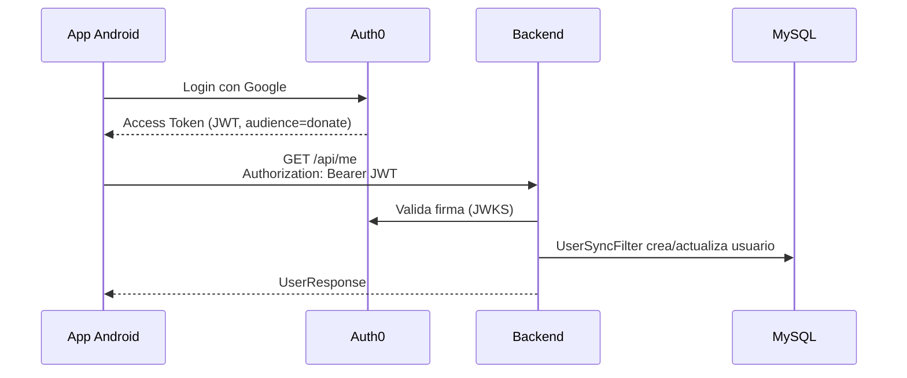

# Donate — Backend API

API REST para una aplicación de donación de sangre. Conecta personas que necesitan sangre con donantes voluntarios, filtrando por tipo sanguíneo y ubicación geográfica (provincias y localidades de Argentina).

---

## Tabla de contenidos

- [Stack tecnológico](#stack-tecnológico)
- [Arquitectura](#arquitectura)
- [Autenticación](#autenticación)
- [Modelo de dominio](#modelo-de-dominio)
- [Reglas de negocio](#reglas-de-negocio)
- [Referencia de API](#referencia-de-api)
- [Flujos principales](#flujos-principales)
- [Configuración](#configuración)
- [Desarrollo local](#desarrollo-local)
- [Tests](#tests)
- [Estructura del proyecto](#estructura-del-proyecto)

---

## Stack tecnológico

| Componente | Tecnología |
|------------|------------|
| Lenguaje | Java 17 |
| Framework | Spring Boot 4.1.0 |
| Persistencia | Spring Data JPA + Hibernate |
| Base de datos | MySQL 8.x (producción/local), H2 (tests) |
| Seguridad | Spring Security + OAuth2 Resource Server (JWT) |
| Identity Provider | Auth0 |
| Geocodificación | Nominatim (OpenStreetMap) |
| Caché | Caffeine |
| Build | Maven |

---

## Arquitectura

```
┌─────────────┐     JWT Bearer      ┌──────────────────────────────────┐
│ App Android │ ──────────────────► │         Spring Boot API          │
│  (Auth0)    │                     │                                  │
└─────────────┘                     │  SecurityConfig (JWT validation) │
                                    │         ↓                        │
                                    │  UserSyncFilter (auto-sync user) │
                                    │         ↓                        │
                                    │  Controllers → Services → JPA    │
                                    └──────────┬───────────┬───────────┘
                                               │           │
                                          MySQL 8     Nominatim API
```

### Capas

| Capa | Paquete | Responsabilidad |
|------|---------|-----------------|
| Controllers | `controller` | Endpoints REST, validación de entrada |
| Services | `service` | Lógica de negocio y transacciones |
| Repositories | `repository` | Acceso a datos (Spring Data JPA) |
| Models | `model` | Entidades JPA y enums |
| DTOs | `dto` | Request/Response records |
| Security | `security` | Filtros de autenticación |
| Config | `config` | Seguridad, CORS, caché, JPA |
| Integration | `integration.nominatim` | Cliente HTTP para geocodificación |

---

## Autenticación

El backend **no maneja login ni contraseñas**. Actúa como **OAuth2 Resource Server**: valida JWT emitidos por Auth0.

### Configuración Auth0

| Parámetro | Valor |
|-----------|-------|
| Domain | `dev-njzfy2r5ryn8mnpt.us.auth0.com` |
| Client ID (Android) | `ZlYTdPZzhbZset4swCnOPhnNrv585PRV` |
| API Audience | `donate` |
| Issuer URI | `https://dev-njzfy2r5ryn8mnpt.us.auth0.com/` |

### Flujo



### Sincronización automática de usuario

En cada request autenticado, `UserSyncFilter` ejecuta `UserService.findOrCreateFromJwt()`:

1. Busca usuario por `auth0Id` (claim `sub` del JWT).
2. Si no existe, lo crea con `email` y `name` del token.
3. Si el JWT no trae `email`, consulta el endpoint `/userinfo` de Auth0.
4. En logins posteriores, actualiza `email` y `name` si cambiaron.

### Endpoints públicos (sin token)

| Método | Ruta |
|--------|------|
| GET | `/actuator/health` |
| GET | `/api/provincias` |
| GET | `/api/provincias/{id}/localidades` |
| GET | `/api/blood-types` |

Todos los demás endpoints requieren header:

```
Authorization: Bearer <access_token>
```

---

## Modelo de dominio

### Entidades

#### `User` (tabla `users`)

| Campo | Tipo | Descripción |
|-------|------|-------------|
| `id` | Long | PK auto-increment |
| `auth0Id` | String | ID único de Auth0 (`sub`) |
| `email` | String | Email del usuario |
| `name` | String | Nombre display |
| `bloodTypesInteres` | Set\<BloodType\> | Tipos de sangre de interés (tabla `user_blood_types_interes`) |
| `provincia` | Provincia | Provincia del usuario |
| `localidadesInteres` | Set\<Localidad\> | Localidades de interés (tabla `user_localidades_interes`) |
| `createdAt` / `updatedAt` | Instant | Auditoría |

**Perfil completo** (`profileComplete = true`) cuando tiene al menos un tipo de sangre, provincia y al menos una localidad.

#### `BloodRequest` (tabla `blood_requests`)

| Campo | Tipo | Descripción |
|-------|------|-------------|
| `id` | Long | PK |
| `creator` | User | Usuario que creó el caso |
| `bloodType` | BloodType | Tipo de sangre requerido |
| `provincia` / `localidad` | FK | Ubicación del caso |
| `direccion` | String | Dirección legible |
| `nombreInstitucion` | String | Hospital/clínica (opcional) |
| `calle` / `numeracion` | String | Componentes de dirección |
| `direccionFormateada` | String | Dirección confirmada por geocodificación |
| `latitud` / `longitud` | BigDecimal | Coordenadas |
| `ubicacionExternalId` | String | ID de Nominatim |
| `description` | String | Descripción libre (opcional) |
| `status` | BloodRequestStatus | `OPEN`, `FULFILLED`, `CANCELLED` |
| `createdAt` / `updatedAt` | Instant | Auditoría |

#### `DonorEnrollment` (tabla `donor_enrollments`)

| Campo | Tipo | Descripción |
|-------|------|-------------|
| `id` | Long | PK |
| `bloodRequest` | BloodRequest | Caso al que se anotó |
| `donor` | User | Donante |
| `createdAt` | Instant | Fecha de inscripción |

Restricción única: `(blood_request_id, donor_id)`.

#### `Provincia` / `Localidad` (tablas preexistentes)

Datos de referencia geográfica de Argentina. Las tablas `provincia` y `localidad` ya existían en la base de datos antes del proyecto.

### Enums

**BloodType**

| Código API | Etiqueta |
|------------|----------|
| `A_POSITIVE` | A+ |
| `A_NEGATIVE` | A- |
| `B_POSITIVE` | B+ |
| `B_NEGATIVE` | B- |
| `AB_POSITIVE` | AB+ |
| `AB_NEGATIVE` | AB- |
| `O_POSITIVE` | O+ |
| `O_NEGATIVE` | O- |

**BloodRequestStatus**: `OPEN`, `FULFILLED`, `CANCELLED`

---

## Reglas de negocio

### Perfil de usuario

- El usuario se crea automáticamente en el primer request autenticado.
- Para crear casos, ver casos recomendados o anotarse como donante, el perfil debe estar **completo**.
- Un usuario puede tener **múltiples tipos de sangre** de interés.

### Casos de sangre (`BloodRequest`)

- Solo usuarios con perfil completo pueden crear casos.
- Al crear un caso, la ubicación debe estar **geocodificada y confirmada** (coordenadas + externalId de Nominatim).
- Solo el **creador** puede editar o cambiar el estado de su caso.
- Solo casos en estado `OPEN` pueden editarse.
- El estado solo puede cambiar a `FULFILLED` o `CANCELLED` (no se puede reabrir por API).

### Inscripciones de donantes (`DonorEnrollment`)

- Un donante solo puede tener **una inscripción activa** a la vez (caso en estado `OPEN`).
- No puede anotarse en su **propio** caso.
- El tipo de sangre del caso debe estar en sus **intereses**.
- No puede anotarse dos veces al mismo caso.
- El creador del caso puede ver la lista de donantes inscritos.
- El donante puede cancelar su inscripción activa.

### Búsqueda de casos

- `GET /api/blood-requests` — listado general con filtros (status por defecto: `OPEN`).
- `GET /api/blood-requests/for-me` — casos que coinciden con los intereses del usuario (tipo de sangre + localidades), excluyendo los propios.

---

## Referencia de API

Base URL: `http://localhost:8080`

### Catálogos (públicos)

#### `GET /api/provincias`

Lista todas las provincias.

**Response 200**

```json
[
  { "id": 1, "nombre": "Ciudad Autónoma de Buenos Aires" },
  { "id": 22, "nombre": "Buenos Aires" }
]
```

#### `GET /api/provincias/{provinciaId}/localidades`

Localidades de una provincia, ordenadas por nombre.

**Response 200**

```json
[
  { "id": 25, "nombre": "Palermo", "provinciaId": 1 }
]
```

#### `GET /api/blood-types`

Tipos de sangre disponibles.

**Response 200**

```json
[
  { "code": "O_POSITIVE", "label": "O+" },
  { "code": "A_NEGATIVE", "label": "A-" }
]
```

---

### Usuario autenticado

#### `GET /api/me`

Devuelve el perfil del usuario logueado. Lo crea si es la primera vez.

**Response 200**

```json
{
  "id": 1,
  "email": "juan@gmail.com",
  "name": "Juan Pérez",
  "bloodTypesInteres": ["O_POSITIVE", "A_POSITIVE"],
  "provincia": { "id": 1, "nombre": "Ciudad Autónoma de Buenos Aires" },
  "localidadesInteres": [
    { "id": 25, "nombre": "Palermo", "provinciaId": 1 }
  ],
  "profileComplete": true
}
```

#### `PATCH /api/me/profile`

Completa o actualiza el perfil.

**Request body**

```json
{
  "bloodTypes": ["O_POSITIVE", "A_POSITIVE"],
  "provinciaId": 1,
  "localidadIds": [25, 46]
}
```

**Validaciones**

- Al menos un `bloodType`, sin duplicados.
- `provinciaId` requerido.
- `localidadIds` requerido; todas deben pertenecer a la provincia indicada.

**Response 200** — `UserResponse`

#### `GET /api/me/enrollment`

Devuelve la inscripción activa del donante (caso OPEN).

**Response 200** — `DonorEnrollmentResponse`

**Response 404** — sin inscripción activa.

#### `DELETE /api/me/enrollment`

Cancela la inscripción activa.

**Response 204** — sin body.

---

### Búsqueda de direcciones

#### `POST /api/locations/search`

Busca candidatos de dirección en Nominatim (OpenStreetMap). Requiere autenticación. Resultados cacheados 30 minutos.

**Request body**

```json
{
  "nombreInstitucion": "Hospital Italiano",
  "provincia": "Ciudad Autónoma de Buenos Aires",
  "localidad": "Palermo",
  "calle": "Av. Gascon",
  "numeracion": "450"
}
```

**Response 200**

```json
[
  {
    "externalId": "123456789",
    "institutionName": "Hospital Italiano de Buenos Aires",
    "formattedAddress": "Hospital Italiano, Gascon 450, Palermo, CABA, Argentina",
    "province": "Ciudad Autónoma de Buenos Aires",
    "locality": "Palermo",
    "latitude": -34.5875000,
    "longitude": -58.4250000
  }
]
```

**Response 503** — Nominatim no disponible.

> El cliente debe permitir al usuario **elegir un candidato** y enviar sus datos al crear el caso.

---

### Casos de sangre

#### `POST /api/blood-requests`

Crea un nuevo caso. Requiere perfil completo.

**Request body**

```json
{
  "bloodType": "O_POSITIVE",
  "provinciaId": 1,
  "localidadId": 25,
  "nombreInstitucion": "Hospital Italiano",
  "calle": "Av. Gascon",
  "numeracion": "450",
  "description": "Urgente para cirugía",
  "direccionFormateada": "Hospital Italiano, Gascon 450, Palermo, CABA",
  "latitud": -34.5875000,
  "longitud": -58.4250000,
  "ubicacionExternalId": "123456789"
}
```

**Response 200** — `BloodRequestResponse`

#### `GET /api/blood-requests`

Lista casos con filtros opcionales.

| Query param | Tipo | Default | Descripción |
|-------------|------|---------|-------------|
| `provinciaId` | Long | — | Filtrar por provincia |
| `localidadIds` | Long[] | — | Filtrar por localidades |
| `bloodType` | BloodType | — | Filtrar por tipo |
| `status` | BloodRequestStatus | `OPEN` | Filtrar por estado |

**Ejemplo:** `GET /api/blood-requests?provinciaId=1&bloodType=O_POSITIVE`

**Response 200** — `BloodRequestResponse[]`

#### `GET /api/blood-requests/mine`

Casos creados por el usuario autenticado.

**Response 200** — `BloodRequestResponse[]`

#### `GET /api/blood-requests/for-me`

Casos recomendados según intereses del usuario (OPEN, tipo de sangre + localidades coincidentes, excluye propios).

**Response 200** — `BloodRequestResponse[]`

**Response 400** — perfil incompleto.

#### `GET /api/blood-requests/{id}`

Detalle de un caso.

**Response 200** — `BloodRequestResponse`

**Response 404** — no encontrado.

#### `PATCH /api/blood-requests/{id}`

Edita dirección y descripción. Solo el creador, solo casos OPEN.

**Request body**

```json
{
  "direccion": "Nueva dirección 123",
  "description": "Descripción actualizada"
}
```

**Response 200** — `BloodRequestResponse`

#### `PATCH /api/blood-requests/{id}/status`

Cierra un caso. Solo el creador, solo casos OPEN.

**Request body**

```json
{
  "status": "FULFILLED"
}
```

Valores permitidos: `FULFILLED`, `CANCELLED`.

**Response 200** — `BloodRequestResponse`

#### `GET /api/blood-requests/{id}/enrollments`

Lista donantes inscritos. Solo el creador del caso.

**Response 200**

```json
[
  {
    "id": 1,
    "donorName": "María García",
    "donorEmail": "maria@gmail.com",
    "createdAt": "2026-08-06T12:00:00Z"
  }
]
```

#### `POST /api/blood-requests/{id}/enrollments`

Inscribirse como donante en un caso.

**Response 200** — `DonorEnrollmentResponse`

**Errores comunes**

| Código | Motivo |
|--------|--------|
| 400 | Perfil incompleto, caso cerrado, tipo de sangre no coincide, caso propio |
| 404 | Caso no encontrado |
| 409 | Ya inscripto en este u otro caso OPEN |

---

### Formato `BloodRequestResponse`

```json
{
  "id": 1,
  "bloodType": "O_POSITIVE",
  "provincia": { "id": 1, "nombre": "Ciudad Autónoma de Buenos Aires" },
  "localidad": { "id": 25, "nombre": "Palermo", "provinciaId": 1 },
  "direccion": "Hospital Italiano, Gascon 450, Palermo, CABA",
  "nombreInstitucion": "Hospital Italiano",
  "calle": "Av. Gascon",
  "numeracion": "450",
  "direccionFormateada": "Hospital Italiano, Gascon 450, Palermo, CABA",
  "latitud": -34.5875000,
  "longitud": -58.4250000,
  "ubicacionExternalId": "123456789",
  "description": "Urgente para cirugía",
  "status": "OPEN",
  "creatorName": "Juan Pérez",
  "createdAt": "2026-08-06T12:00:00Z"
}
```

---

## Flujos principales

### 1. Registro y perfil

```
Login Auth0 → GET /api/me → PATCH /api/me/profile
```

No hay endpoint de registro manual. El usuario se crea en el primer request autenticado.

### 2. Crear un caso de sangre

```
POST /api/locations/search   (buscar dirección)
  → usuario elige candidato
POST /api/blood-requests     (crear caso con coordenadas confirmadas)
```

### 3. Donante se anota en un caso

```
GET /api/blood-requests/for-me   (ver casos compatibles)
POST /api/blood-requests/{id}/enrollments
GET /api/me/enrollment           (ver inscripción activa)
DELETE /api/me/enrollment        (cancelar)
```

### 4. Creador gestiona su caso

```
GET /api/blood-requests/mine
GET /api/blood-requests/{id}/enrollments
PATCH /api/blood-requests/{id}/status   (marcar FULFILLED o CANCELLED)
```

---

## Configuración

La app usa **perfiles de Spring** para separar entorno local y producción (Railway) sin cambiar código.

| Perfil | Archivo | Cuándo se usa |
|--------|---------|---------------|
| `local` (default) | `application-local.properties` | Desarrollo en tu máquina |
| `prod` | `application-prod.properties` | Railway |
| `test` | `src/test/resources/application.properties` | Tests (H2) |

### `application.properties` (común)

Propiedades compartidas por todos los perfiles:

```properties
spring.profiles.active=${SPRING_PROFILES_ACTIVE:local}

auth0.domain=${AUTH0_DOMAIN:dev-njzfy2r5ryn8mnpt.us.auth0.com}
auth0.client-id=${AUTH0_CLIENT_ID:ZlYTdPZzhbZset4swCnOPhnNrv585PRV}
auth0.audience=${AUTH0_AUDIENCE:donate}

server.port=${PORT:8080}
spring.jpa.hibernate.ddl-auto=update
spring.jpa.open-in-view=false
```

No contiene configuración de datasource — eso vive en el perfil activo.

### Perfil local (`application-local.properties`)

Archivo **gitignored** con credenciales de MySQL local. Copiar desde el ejemplo:

```bash
cp src/main/resources/application-local.properties.example src/main/resources/application-local.properties
```

```properties
spring.datasource.url=jdbc:mysql://localhost:3306/donate?useSSL=false&...
spring.datasource.username=root
spring.datasource.password=TU_PASSWORD
spring.datasource.driver-class-name=com.mysql.cj.jdbc.Driver
```

Por defecto arranca con perfil `local` (no hace falta setear nada).

### Perfil prod — Railway (`application-prod.properties`)

```properties
spring.datasource.url=jdbc:mysql://${MYSQLHOST}:${MYSQLPORT}/${MYSQLDATABASE}?useSSL=false&allowPublicKeyRetrieval=true&serverTimezone=UTC
spring.datasource.username=${MYSQLUSER}
spring.datasource.password=${MYSQLPASSWORD}
spring.datasource.driver-class-name=com.mysql.cj.jdbc.Driver
```

En Railway, vinculá el servicio MySQL al backend. Las variables `MYSQLHOST`, `MYSQLPORT`, `MYSQLDATABASE`, `MYSQLUSER` y `MYSQLPASSWORD` las inyecta Railway automáticamente.

El perfil `prod` se activa solo cuando Railway expone `MYSQLHOST` o `RAILWAY_ENVIRONMENT`. También podés forzar:

```
SPRING_PROFILES_ACTIVE=prod
```

Variables adicionales recomendadas en Railway:

```
NOMINATIM_CONTACT_EMAIL=tu-email@dominio.com
```

### Variables de entorno

| Variable | Perfil | Descripción |
|----------|--------|-------------|
| `SPRING_PROFILES_ACTIVE` | todos | `local` (default) o `prod` (auto en Railway) |
| `PORT` | todos | Puerto del servidor (Railway lo inyecta) |
| `MYSQLHOST` | prod | Host MySQL (Railway) |
| `MYSQLPORT` | prod | Puerto MySQL (Railway) |
| `MYSQLDATABASE` | prod | Nombre de la base (Railway) |
| `MYSQLUSER` | prod | Usuario MySQL (Railway) |
| `MYSQLPASSWORD` | prod | Contraseña MySQL (Railway) |
| `AUTH0_DOMAIN` | todos | Override del dominio Auth0 |
| `AUTH0_CLIENT_ID` | todos | Override del client ID Auth0 |
| `AUTH0_AUDIENCE` | todos | Override del audience Auth0 |
| `NOMINATIM_CONTACT_EMAIL` | todos | Email para User-Agent de Nominatim |

### CORS

Orígenes permitidos para `/api/**`:

- `http://localhost:*`
- `capacitor://localhost`
- `ionic://localhost`

---

## Desarrollo local

### Requisitos

- JDK 17+
- MySQL 8.x con base `donate` creada
- Tablas `provincia` y `localidad` con datos de referencia

### Opción A — MySQL local

1. Crear la base de datos:

```sql
CREATE DATABASE donate CHARACTER SET utf8mb4 COLLATE utf8mb4_unicode_ci;
```

2. Configurar credenciales en `application-local.properties`.

3. Ejecutar:

```bash
./mvnw spring-boot:run
```

La API queda en `http://localhost:8080`.

### Opción B — Docker Compose

```bash
docker compose up -d
```

Levanta MySQL 8.4 en el puerto 3306 con usuario `donate` / password `secret`.

> Por defecto `spring.docker.compose.enabled=false`. Activarlo si querés que Spring Boot arranque Compose automáticamente.

### Probar endpoints públicos

```bash
curl http://localhost:8080/api/provincias
curl http://localhost:8080/api/blood-types
curl http://localhost:8080/api/provincias/1/localidades
```

### Probar endpoints autenticados

Obtener un access token desde la app Android (Auth0 SDK) o el dashboard de Auth0 con audience `donate`:

```bash
curl -H "Authorization: Bearer TU_TOKEN" http://localhost:8080/api/me
```

---

## Tests

```bash
./mvnw test
```

- Usan perfil `test` con base H2 en memoria.
- `TestSecurityConfig` desactiva OAuth2 y permite inyectar JWT de prueba.
- Cubren servicios de usuario, casos de sangre, inscripciones y búsqueda de direcciones.

---

## Estructura del proyecto

```
src/main/java/com/donate/app/
├── DonateApplication.java
├── config/
│   ├── CacheConfig.java          # Caché Caffeine para búsqueda de direcciones
│   ├── JpaConfig.java            # JPA auditing
│   ├── LocationDataLoader.java   # Carga de datos de prueba (si aplica)
│   ├── NominatimProperties.java  # Config de Nominatim
│   ├── SecurityConfig.java       # OAuth2 Resource Server
│   └── WebConfig.java            # CORS
├── controller/
│   ├── BloodRequestController.java
│   ├── BloodTypeController.java
│   ├── LocationController.java
│   ├── LocationSearchController.java
│   └── MeController.java
├── dto/                          # Records request/response
├── integration/nominatim/        # Cliente Nominatim
├── model/                        # Entidades JPA y enums
├── repository/                   # Spring Data JPA
├── security/
│   └── UserSyncFilter.java       # Auto-sync usuario desde JWT
└── service/
    ├── Auth0UserInfoClient.java
    ├── BloodRequestService.java
    ├── DonorEnrollmentService.java
    ├── LocationSearchService.java
    ├── LocationService.java
    └── UserService.java

src/test/java/com/donate/app/
├── config/TestSecurityConfig.java
├── service/                      # Tests de integración de servicios
└── support/                      # Helpers de test
```

---

## Códigos de error HTTP

| Código | Uso |
|--------|-----|
| 400 | Validación de negocio (perfil incompleto, reglas de inscripción, etc.) |
| 401 | Token ausente o inválido |
| 403 | Sin permisos (ej. editar caso ajeno) |
| 404 | Recurso no encontrado |
| 409 | Conflicto (inscripción duplicada) |
| 503 | Nominatim no disponible |

Los errores de validación devuelven un body JSON estándar de Spring (`ResponseStatusException`):

```json
{
  "status": 400,
  "error": "Bad Request",
  "message": "Complete your profile before creating a case"
}
```
